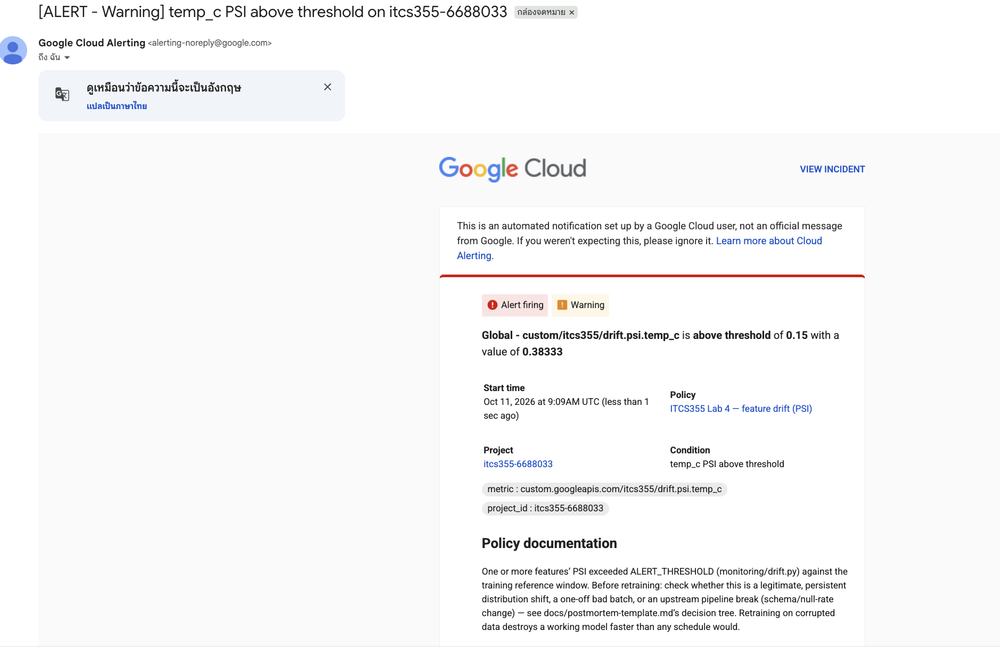
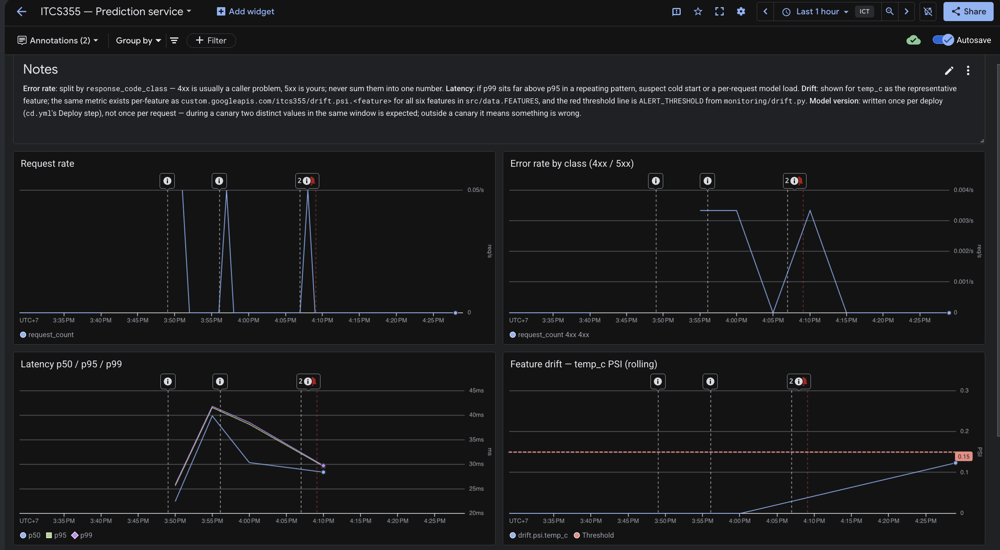

# Lab 4 — CI/CD, Observability, and Drift

---

## What this lab delivers

- Four test categories (unit, data contract, model behaviour, integration), each one
  that can fail for a real reason
- CI pipeline: lint → unit → data contract → model behaviour → build → integration
  test → push (main only) → deploy to staging (main only)
- Evidence of a deliberately bad commit blocked by CI
- A dashboard covering request rate, error rate (4xx/5xx), latency p50/p95/p99,
  feature drift, and model version
- An SLO with a stated error-budget response
- A scheduled drift detector with a justified threshold, alerting by email
- An injected-drift exercise with timestamped evidence and a post-mortem

---

## Task 1 — Tests that can actually fail

I reused the existing Lab 1–3 code and dataset; nothing here trains a new model.

- **Unit** (new: `tests/test_unit.py`) — covers `src/data.py` and `monitoring/drift.py`'s
  PSI/KS math, which nothing tested before this.
- **Data** (existing: `tests/test_data.py`) — contract and split-logic tests, including
  the Lab 1 machine-leakage test.
- **Model behaviour** (existing) — set `LATENCY_BUDGET_MS = 50 ms`, a quarter of the
  200 ms end-to-end p95 in `loadtest/k6.js:64` (this test only measures in-process
  `predict_proba`, not the full request).
- **Integration** (extended) — now asserts the full response shape and that
  `model_version` matches the commit SHA, via `jq -e`.

**What the data contract tests would catch** (examples, not production incidents —
this project has never served real traffic):

| Data contract | Problem it would catch |
|---|---|
| Columns and types | Upstream renames `load_pct`, or a dtype silently changes. |
| No nulls in required columns | A sensor drops out, leaving missing values. |
| Plausible ranges | `temp_c` reported in Fahrenheit, or an impossible `load_pct = 250`. |
| Labels 0/1, positive rate 1–99% | Every row relabelled `0`, or failures miscoded. |
| Unique `reading_id` | An ingestion retry double-writes a batch. |
| No machine leaks across splits | `split()` refactored to split by row instead of machine. |

I validated this against 9 deliberately corrupted copies of the dataframe — **9/9
rejected**.

---

## Task 2 — CI pipeline

I set up GCP Workload Identity Federation (no stored keys): a WIF pool + GitHub OIDC
provider scoped to this repo, and a deploy service account impersonated through it.
`ci.yml` now pushes the SHA-tagged image on main; `cd.yml` deploys to a
**staging-only** Cloud Run service (`itcs355-predict-staging`, tagged `lab=4`) and
runs the existing smoke test.

Verified live: the staging service carries `lab: '4'`; smoke test passed 3/3 on two
consecutive runs.

**Problems I hit and fixed:**

| Problem | Fix |
|---|---|
| `ImportError: aiplatform_v1` | `requirements.txt` never locked `google-cloud-aiplatform`. Added it, regenerated with `uv pip compile` (the tool the lockfile was originally built with). |
| `403 aiplatform.models.get` | Deploy SA had no Vertex AI read access — granted `roles/aiplatform.viewer`. |
| `PERMISSION_DENIED` impersonating the training SA | The token fallback chain's ambient tier is flaky under WIF (passed once, failed identically the next run). Pointed the smoke test at self-impersonation of the deploy SA instead. |
| `InvalidHeader` once impersonation succeeded | Real bug in `cloudlayer/gcp.py`: `gcloud`'s impersonation warning was getting merged into the token string. Fixed by taking only the last non-blank line. |

---

## Task 3 — Prove a bad commit is blocked

I opened [PR #7](https://github.com/Nuay-coder/itcs355-lab/pull/7) generating `temp_c`
in Fahrenheit. CI's `test` job failed in 70s on
`tests/test_data.py::test_features_within_plausible_ranges`, and `build` was skipped
entirely since it `needs: test`. Closed without merging. Full evidence in
[`reports/lab4-ci-evidence.md`](../../reports/lab4-ci-evidence.md).

---

## Task 4 — Instrumentation, dashboard, SLO

I implemented `emit_metric` via Cloud Monitoring's REST `timeSeries.create` API (no
`gcloud` command exists for it) — verified the point lands via `timeSeries.list`.

For request rate, error rate, and latency I used **Cloud Run's own free built-in
metrics** instead of instrumenting `service/app.py` — same signals, without adding a
network call to the request path the 200ms latency budget is trying to protect. Model
version is emitted once per deploy (not per request); confirmed across 3 CD runs.

I translated the Grafana-style `monitoring/dashboard.json` into
`monitoring/dashboard.gcp.json` and created it live
(`gcloud monitoring dashboards create`) — fixed two real schema rejections along the
way (an `xyChart` threshold only accepts `value`, not `color`/`direction`). This API
has no label support, so teardown has to delete it by id explicitly.

I filled `monitoring/slo.yaml`: availability 99.5%/30d, latency p95<200ms (matches
`loadtest/k6.js:64`), freshness ≤30 days. Every objective's budget-exhausted response
names a concrete action (freeze+rollback, or trigger retraining).

---

## Task 5 — Scheduled drift detection

**Threshold** (`ALERT_THRESHOLD = 0.15`) — measured, not copied: I compared disjoint
random samples of the training data against itself at the same 500-row window size
the scheduled job uses. Pure noise there runs p99≈0.087; the actual injected drift
scores 0.369. 0.15 sits well above noise and well below signal.

**Gap I'm stating plainly**: this project has no real traffic and no logging sink
persisting recent request features. "Recent production inputs" is a file at
`gs://<bucket>/lab4/current.csv` that Task 6 overwrites deliberately — a real system
would populate it from an actual logging sink instead.

**Verified live:** Cloud Run Job (`itcs355-lab4-drift`) executes and logs the drift
table correctly. Cloud Scheduler (hourly) triggers it via the Cloud Run Jobs REST API
— I confirmed a scheduler-initiated execution actually ran, not just a manual one.
Email notification channel created and **verified**. Alert policy has one condition
per feature (the feature name lives in the metric *type*, not a label, so a single
wildcard condition isn't possible — confirmed `monitoring.regex.full_match` is
rejected on `metric.type`). I extended `teardown()` to find all of these; confirmed
the filters match but haven't run it yet since Task 6 needs them alive.

---

## Task 6 — The injected drift exercise

**Which statistic catches which mode** — ran all three `inject_drift.py` modes
against `temp_c`:

| Mode | PSI | KS | Alert fired? |
|---|---|---|---|
| `shift` (+6 mean) | 0.383 | 0.246 | Yes |
| `scale` (×6 spread) | 1.904 | 0.383 | Yes |
| `mix` (reweight 1/5 of machines) | 0.009 | 0.034 | **No** |

`mix` genuinely didn't trigger — real numbers behind the handout's "hardest to spot"
claim about it.

**The real exercise, through the actual scheduled path:**

| Event | Time (UTC) |
|---|---|
| Injected `temp_c +6`, uploaded to `gs://.../lab4/current.csv` | `09:05:40` |
| Triggered via the real Cloud Scheduler job | `09:06:00` |
| Job ran, scored PSI=0.383, exited 2 (ALERT) | `09:06:08` |
| Metric landed in Cloud Monitoring | `09:06:37` |
| **Alert email fired** | `09:09:00` |

**Detection latency: 3m20s** (injection → alert), of which 2m23s was Cloud
Monitoring's own evaluation delay after the metric landed — the job itself ran in
under 30s. This run used a manual scheduler trigger right after injection; at the
real hourly cadence, worst-case production latency is up to ~1 hour plus that same
~2–3 minute evaluation delay.

*Cloud Monitoring has no API for listing fired incidents — the email is the primary
evidence here, not a queryable response like everywhere else in this lab.*

*The "Feature drift — temp_c PSI" panel climbing to meet the red threshold line, on
the same live dashboard from Task 4.*

**Post-mortem:**

**What fired:** `temp_c` PSI alert, value 0.383 vs threshold 0.15, at `09:09:00Z`.

**True cause:** A synthetic injection (`inject_drift.py --mode shift`), not a real
event — schema and null rate were unchanged.

**Retrain, roll back, or no action:** No action. One test run isn't evidence of a
persistent shift; retraining on it would mean retraining on a value I manufactured.

**Cost if unnoticed for a week:** Assuming all 240 fleet machines (`src/data.py`'s
`N_MACHINES`) got scored hourly, `240 × 24 × 7 = 40,320` predictions would run
against the shifted `temp_c` over the week. That's an exposure estimate, not a count
of actually-wrong predictions or real money lost — this service has no real traffic
or cost-per-dispatch figure, and my test used one batch, not continuous scoring.

**Prevent/detect faster:** Tighten the hourly Scheduler cadence (e.g. to 15 min), and
add a mean-shift check alongside PSI — `mix`, the most realistic mode, didn't alert
at this magnitude.

---

## Reports

- [`reports/lab4-ci-evidence.md`](../../reports/lab4-ci-evidence.md) — Task 3's
  failing-PR evidence.
