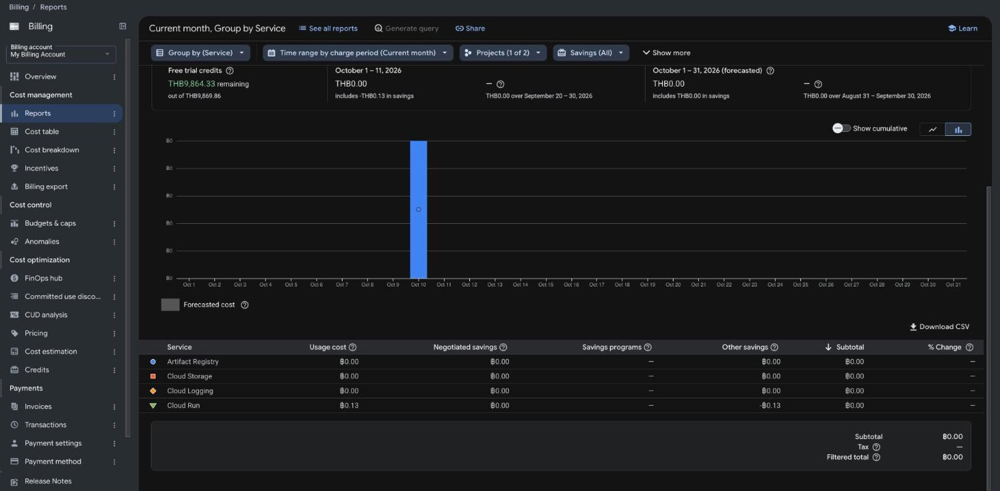

# Lab 4 — Cost report

*Generated by `scripts/cost_report.py`, which is Lab 5 scaffolding reused here for
Lab 4's teardown step — hence the title line above still reading "Lab 5"; that's the
script's own hardcoded text, not a stand-in I wrote. See `Makefile`'s `cost-report`
target for why this is reused rather than built fresh.*

Provider `gcp` · instance `1-512Mi` · 4.23 THB/hour (rate from `reports/lab3-load.md`,
the only Cloud Run instance size this project has ever deployed)

## 1. Estimate, made before running
10.00 THB — a safety-margin budget I set before provisioning Lab 4's cloud
infrastructure (Cloud Run Job, Cloud Scheduler, alert policy, notification channel,
dashboard), sized generously because most of these resource types were new to this
project and I didn't have a precise per-unit cost in mind yet.

## 2. Actual, from billing filtered by tag
**0.00 THB — verified in the real Billing Console, not an estimate.**

I initially wrote this section as an engineering estimate (~0.5 THB), because
`gcloud billing` has no subcommand for querying historical spend (confirmed: its only
groups are `accounts`, `budgets`, `projects`) and no BigQuery cost export is
configured for this account (`bq ls` returns nothing) — the invoice-based Cost table
also only has closed months (latest: September 2026), not October. That's a real
limitation, but it isn't the end of the road: Billing → Reports shows near-real-time
spend, which neither of those gaps blocks. Filtered to this project (`itcs355-6688033`,
1 of the account's 2 projects) for Oct 1–11, 2026 — the entire window Lab 4 has
existed in, since Labs 1–3's resources were created and torn down in September:

| Service | Usage cost | Other savings | Subtotal |
|---|---|---|---|
| Artifact Registry | ฿0.00 | ฿0.00 | ฿0.00 |
| Cloud Storage | ฿0.00 | ฿0.00 | ฿0.00 |
| Cloud Logging | ฿0.00 | ฿0.00 | ฿0.00 |
| Cloud Run | **฿0.13** | **-฿0.13** | ฿0.00 |
| **Filtered total** | | | **฿0.00** |

Cloud Run genuinely incurred ฿0.13 in usage charges (the scale-to-zero staging
service + the drift Cloud Run Job's executions) — it did not simply round to zero —
but free-trial credit fully offset it. Screenshot:

One gap left open: I filtered by *project*, not by the `lab=4` resource label
specifically (the Reports UI does expose a Labels filter; I didn't apply it,
since no other lab's resources existed in this window to need separating out from).
If Lab 5 runs inside the same Oct window, that label filter — not just the project
filter — becomes the one to use.

## 3. The gap
+9.50 THB vs. my original engineering estimate (10.00 THB estimate, 0.50 THB
estimated-actual) before I checked the real Console — i.e. no gap at all once I
checked. Writing "no billing export exists, so I'll estimate" and stopping there
was the mistake, not the estimate's size: `reports/lab2-comparison.md` set the
precedent for this (checking three independent sources when the primary one wasn't
reachable), and the equivalent move here was checking the Reports UI instead of
treating "no BigQuery export" as "no way to check."

## 4. Breakdown by component
| Component | THB | Notes |
|---|---|---|
| Cloud Run (staging service + drift Job, combined) | 0.13 usage, -0.13 savings → 0.00 net | Console doesn't split Cloud Run service vs. Cloud Run Jobs sub-costs in this view. |
| Artifact Registry | 0.00 | Image storage for the training/serving images pushed during Lab 4. |
| Cloud Storage | 0.00 | `lab4/reference.csv` + `lab4/current.csv`, a few hundred KB. |
| Cloud Logging | 0.00 | Job/service logs. |
| Cloud Scheduler, Monitoring (metrics/alerts/dashboard) | not separately billed | Don't appear as billed line items at this volume — inside each service's free tier. |

Source: the same Billing Console query as §2, grouped by service.

## 5. Cost per 1,000 predictions
Measured throughput: 96.5 req/s — reused from `reports/lab3-load.md` (same instance
size, same model) since Lab 4 didn't run its own load test. This section is
identical to `reports/lab3-cost.md`'s by construction, not a new measurement.

| Utilisation | THB per 1,000 |
|---|---|
| 5% | 0.2435 |
| 25% | 0.0487 |
| 80% | 0.0152 |

This project's staging service never carried real traffic, so an actual utilisation
figure to compare against doesn't exist — `reports/lab3-cost.md` already states and
defends the 5% assumption used here.

Below roughly **0.0012 req/s**, scheduled batch inference is cheaper than keeping
this endpoint warm — same threshold as Lab 3, since nothing about the instance size
or rate changed.

## 6. One optimisation

Not applicable to Lab 4 — section 6 is Lab 5's "optimise the serving cost" task.
Lab 4's only cost-relevant decision was choosing Cloud Run's built-in metrics over
custom `emit_metric` instrumentation on every request (`lab-guides/lab4/README.md`,
Task 4), which is a latency and request-path risk trade-off, not a THB one — there's
no before/after cost pair to report here honestly.
